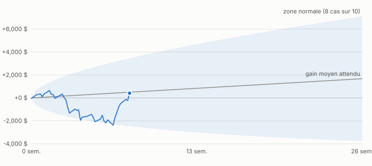

# Robot multi-marches : tableau de bord (argent virtuel)

Mis a jour le **2026-11-27**. Deux comptes virtuels de 50 000 $, risque vise 12 %/an (environ 6 000 $). Aucun argent reel n'est engage.

| Compte | Solde | Gain | Etat |
|---|---|---|---|
| Melange 50/50 (tendance + achat permanent) | 48,079 $ | -1,921 $ | 🟡 Dans la zone normale |
| Tendance seule | 49,917 $ | -83 $ | 🟡 Dans la zone normale |

La zone bleue de chaque graphique montre ou tombaient 8 resultats sur 10 dans l'historique 2007-2026, au meme risque. Tant que la ligne reste dedans, le compte se comporte comme prevu. Des semaines negatives sont normales : il faut plusieurs mois pour juger.

## Melange 50/50 (tendance + achat permanent)

Demarre le 2026-09-25. Historique 2007-2026 au meme risque : Sharpe 0,78, environ +9 %/an en moyenne, pire baisse -19 %, 3 annees sur 4 positives.

**🟡 Dans la zone normale : se comporte comme sur les 20 ans d'historique.**

| Mesure | Valeur |
|---|---|
| Solde virtuel | **48,079 $** (depart 50 000 $) |
| Gain depuis le depart | -1,921 $ (-3.8%) |
| Baisse depuis le plus haut | -4.4% |
| Zone normale a ce stade (8 cas sur 10) | de -2,389 $ a +4,009 $ (moyenne +810 $) |
| Challenge Phidias 50K virtuel | en cours : -1,921 $ sur +4 000 $, marge restante 303 $ |

| Contrat | Marche | Sens | Nombre |
|---|---|---|---|
| MET | Ether | Vente | 6 |
| M6E | Euro | Vente | 1 |

10 derniers jours

| Date | Resultat du jour | Solde |
|---|---|---|
| 2026-11-27 | +57 $ | 48,079 $ |
| 2026-11-25 | -14 $ | 48,035 $ |
| 2026-11-24 | -82 $ | 48,049 $ |
| 2026-11-23 | +62 $ | 48,130 $ |
| 2026-11-20 | -39 $ | 48,068 $ |
| 2026-11-19 | -66 $ | 48,152 $ |
| 2026-11-18 | +3 $ | 48,219 $ |
| 2026-11-17 | -8 $ | 48,216 $ |
| 2026-11-16 | -135 $ | 48,224 $ |
| 2026-11-13 | +18 $ | 48,358 $ |

Journal complet : [journal_melange.csv](journal_melange.csv)

## Tendance seule

Demarre le 2026-09-25. Historique 2007-2026 au meme risque : Sharpe 0,56, environ +7 %/an en moyenne, pire baisse -23 %, 13 annees sur 20 positives.

**🟡 Dans la zone normale : se comporte comme sur les 20 ans d'historique.**

| Mesure | Valeur |
|---|---|
| Solde virtuel | **49,917 $** (depart 50 000 $) |
| Gain depuis le depart | -83 $ (-0.2%) |
| Baisse depuis le plus haut | -1.4% |
| Zone normale a ce stade (8 cas sur 10) | de -2,618 $ a +3,781 $ (moyenne +582 $) |
| Challenge Phidias 50K virtuel | perdu le 2026-10-22 |

| Contrat | Marche | Sens | Nombre |
|---|---|---|---|
| MET | Ether | Vente | 6 |
| MSF | Franc suisse | Vente | 2 |
| 2YY | Taux 2 ans | Achat | 1 |
| M6E | Euro | Vente | 1 |
| MHG | Cuivre | Vente | 1 |
| MBT | Bitcoin | Vente | 1 |

10 derniers jours

| Date | Resultat du jour | Solde |
|---|---|---|
| 2026-11-27 | +34 $ | 49,917 $ |
| 2026-11-25 | -293 $ | 49,903 $ |
| 2026-11-24 | +246 $ | 50,196 $ |
| 2026-11-23 | -483 $ | 49,949 $ |
| 2026-11-20 | -144 $ | 50,432 $ |
| 2026-11-19 | +204 $ | 50,618 $ |
| 2026-11-18 | +634 $ | 50,415 $ |
| 2026-11-17 | -94 $ | 49,780 $ |
| 2026-11-16 | +377 $ | 49,874 $ |
| 2026-11-13 | +363 $ | 49,497 $ |

Journal complet : [journal.csv](journal.csv)

Contrats de taux (2YY, 10Y, 30Y) : le sens indique est celui de l'ordre sur le contrat, inverse de celui des obligations. Methode et resultats historiques : [../README.md](../README.md).
