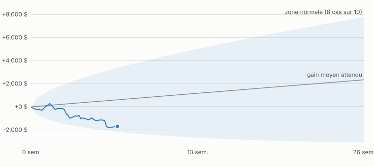
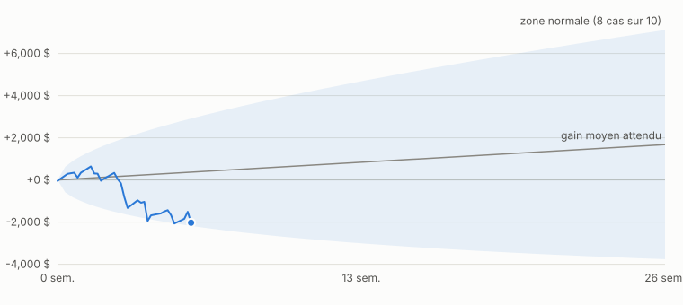

# Robot multi-marches : tableau de bord (argent virtuel)

Mis a jour le **2026-11-11**. Deux comptes virtuels de 50 000 $, risque vise 12 %/an (environ 6 000 $). Aucun argent reel n'est engage.

| Compte | Solde | Gain | Etat |
|---|---|---|---|
| Melange 50/50 (tendance + achat permanent) | 48,308 $ | -1,692 $ | 🟡 Dans la zone normale |
| Tendance seule | 48,711 $ | -1,289 $ | 🟡 Dans la zone normale |

La zone bleue de chaque graphique montre ou tombaient 8 resultats sur 10 dans l'historique 2007-2026, au meme risque. Tant que la ligne reste dedans, le compte se comporte comme prevu. Des semaines negatives sont normales : il faut plusieurs mois pour juger.

## Melange 50/50 (tendance + achat permanent)

Demarre le 2026-09-25. Historique 2007-2026 au meme risque : Sharpe 0,78, environ +9 %/an en moyenne, pire baisse -19 %, 3 annees sur 4 positives.

**🟡 Dans la zone normale : se comporte comme sur les 20 ans d'historique.**

| Mesure | Valeur |
|---|---|
| Solde virtuel | **48,308 $** (depart 50 000 $) |
| Gain depuis le depart | -1,692 $ (-3.4%) |
| Baisse depuis le plus haut | -3.9% |
| Zone normale a ce stade (8 cas sur 10) | de -2,159 $ a +3,367 $ (moyenne +604 $) |
| Challenge Phidias 50K virtuel | en cours : -1,692 $ sur +4 000 $, marge restante 532 $ |

| Contrat | Marche | Sens | Nombre |
|---|---|---|---|
| MET | Ether | Vente | 8 |
| 10Y | Taux 10 ans | Achat | 1 |
| MCD | Dollar canadien | Achat | 1 |
| MBT | Bitcoin | Achat | 1 |

10 derniers jours

| Date | Resultat du jour | Solde |
|---|---|---|
| 2026-11-11 | -30 $ | 48,308 $ |
| 2026-11-10 | +91 $ | 48,338 $ |
| 2026-11-09 | +39 $ | 48,247 $ |
| 2026-11-06 | -67 $ | 48,208 $ |
| 2026-11-05 | -526 $ | 48,297 $ |
| 2026-11-04 | -21 $ | 48,823 $ |
| 2026-11-03 | -17 $ | 48,844 $ |
| 2026-11-02 | +51 $ | 48,861 $ |
| 2026-10-30 | -83 $ | 48,811 $ |
| 2026-10-29 | -136 $ | 48,910 $ |

Journal complet : [journal_melange.csv](journal_melange.csv)

## Tendance seule

Demarre le 2026-09-25. Historique 2007-2026 au meme risque : Sharpe 0,56, environ +7 %/an en moyenne, pire baisse -23 %, 13 annees sur 20 positives.

**🟡 Dans la zone normale : se comporte comme sur les 20 ans d'historique.**

| Mesure | Valeur |
|---|---|
| Solde virtuel | **48,711 $** (depart 50 000 $) |
| Gain depuis le depart | -1,289 $ (-2.6%) |
| Baisse depuis le plus haut | -3.8% |
| Zone normale a ce stade (8 cas sur 10) | de -2,329 $ a +3,197 $ (moyenne +434 $) |
| Challenge Phidias 50K virtuel | perdu le 2026-10-22 |

| Contrat | Marche | Sens | Nombre |
|---|---|---|---|
| M6A | Dollar australien | Vente | 3 |
| 10Y | Taux 10 ans | Achat | 2 |
| MET | Ether | Vente | 2 |
| 2YY | Taux 2 ans | Achat | 1 |
| M6E | Euro | Vente | 1 |
| MSF | Franc suisse | Vente | 1 |
| MNG | Gaz naturel | Vente | 1 |

10 derniers jours

| Date | Resultat du jour | Solde |
|---|---|---|
| 2026-11-11 | +413 $ | 48,711 $ |
| 2026-11-10 | +673 $ | 48,298 $ |
| 2026-11-09 | -468 $ | 47,625 $ |
| 2026-11-06 | +296 $ | 48,093 $ |
| 2026-11-05 | -141 $ | 47,833 $ |
| 2026-11-04 | -516 $ | 47,973 $ |
| 2026-11-03 | +330 $ | 48,489 $ |
| 2026-11-02 | +224 $ | 48,160 $ |
| 2026-10-30 | -355 $ | 47,936 $ |
| 2026-10-29 | -234 $ | 48,333 $ |

Journal complet : [journal.csv](journal.csv)

Contrats de taux (2YY, 10Y, 30Y) : le sens indique est celui de l'ordre sur le contrat, inverse de celui des obligations. Methode et resultats historiques : [../README.md](../README.md).
