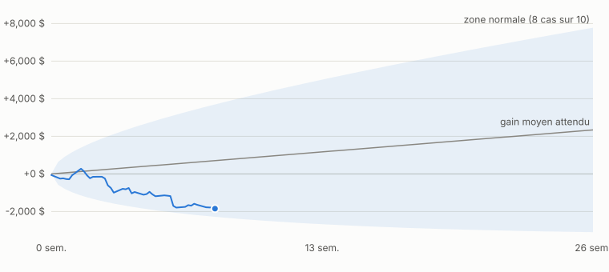

# Robot multi-marches : tableau de bord (argent virtuel)

Mis a jour le **2026-11-18**. Deux comptes virtuels de 50 000 $, risque vise 12 %/an (environ 6 000 $). Aucun argent reel n'est engage.

| Compte | Solde | Gain | Etat |
|---|---|---|---|
| Melange 50/50 (tendance + achat permanent) | 48,219 $ | -1,781 $ | 🟡 Dans la zone normale |
| Tendance seule | 50,415 $ | +415 $ | 🟡 Dans la zone normale |

La zone bleue de chaque graphique montre ou tombaient 8 resultats sur 10 dans l'historique 2007-2026, au meme risque. Tant que la ligne reste dedans, le compte se comporte comme prevu. Des semaines negatives sont normales : il faut plusieurs mois pour juger.

## Melange 50/50 (tendance + achat permanent)

Demarre le 2026-09-25. Historique 2007-2026 au meme risque : Sharpe 0,78, environ +9 %/an en moyenne, pire baisse -19 %, 3 annees sur 4 positives.

**🟡 Dans la zone normale : se comporte comme sur les 20 ans d'historique.**

| Mesure | Valeur |
|---|---|
| Solde virtuel | **48,219 $** (depart 50 000 $) |
| Gain depuis le depart | -1,781 $ (-3.6%) |
| Baisse depuis le plus haut | -4.1% |
| Zone normale a ce stade (8 cas sur 10) | de -2,267 $ a +3,656 $ (moyenne +694 $) |
| Challenge Phidias 50K virtuel | en cours : -1,781 $ sur +4 000 $, marge restante 443 $ |

| Contrat | Marche | Sens | Nombre |
|---|---|---|---|
| MET | Ether | Achat | 10 |
| M6E | Euro | Vente | 1 |
| M6A | Dollar australien | Achat | 1 |
| MCD | Dollar canadien | Achat | 1 |

10 derniers jours

| Date | Resultat du jour | Solde |
|---|---|---|
| 2026-11-18 | +3 $ | 48,219 $ |
| 2026-11-17 | -8 $ | 48,216 $ |
| 2026-11-16 | -135 $ | 48,224 $ |
| 2026-11-13 | +18 $ | 48,358 $ |
| 2026-11-12 | +103 $ | 48,411 $ |
| 2026-11-11 | -30 $ | 48,308 $ |
| 2026-11-10 | +91 $ | 48,338 $ |
| 2026-11-09 | +39 $ | 48,247 $ |
| 2026-11-06 | -67 $ | 48,208 $ |
| 2026-11-05 | -526 $ | 48,297 $ |

Journal complet : [journal_melange.csv](journal_melange.csv)

## Tendance seule

Demarre le 2026-09-25. Historique 2007-2026 au meme risque : Sharpe 0,56, environ +7 %/an en moyenne, pire baisse -23 %, 13 annees sur 20 positives.

**🟡 Dans la zone normale : se comporte comme sur les 20 ans d'historique.**

| Mesure | Valeur |
|---|---|
| Solde virtuel | **50,415 $** (depart 50 000 $) |
| Gain depuis le depart | +415 $ (+0.8%) |
| Baisse depuis le plus haut | -0.5% |
| Zone normale a ce stade (8 cas sur 10) | de -2,463 $ a +3,460 $ (moyenne +498 $) |
| Challenge Phidias 50K virtuel | perdu le 2026-10-22 |

| Contrat | Marche | Sens | Nombre |
|---|---|---|---|
| MET | Ether | Vente | 8 |
| MSF | Franc suisse | Vente | 2 |
| 10Y | Taux 10 ans | Achat | 1 |
| 30Y | Taux 30 ans | Achat | 1 |
| M6A | Dollar australien | Achat | 1 |
| MHG | Cuivre | Vente | 1 |
| MNG | Gaz naturel | Vente | 1 |

10 derniers jours

| Date | Resultat du jour | Solde |
|---|---|---|
| 2026-11-18 | +634 $ | 50,415 $ |
| 2026-11-17 | -94 $ | 49,780 $ |
| 2026-11-16 | +377 $ | 49,874 $ |
| 2026-11-13 | +363 $ | 49,497 $ |
| 2026-11-12 | +475 $ | 49,186 $ |
| 2026-11-11 | +413 $ | 48,711 $ |
| 2026-11-10 | +673 $ | 48,298 $ |
| 2026-11-09 | -468 $ | 47,625 $ |
| 2026-11-06 | +296 $ | 48,093 $ |
| 2026-11-05 | -141 $ | 47,833 $ |

Journal complet : [journal.csv](journal.csv)

Contrats de taux (2YY, 10Y, 30Y) : le sens indique est celui de l'ordre sur le contrat, inverse de celui des obligations. Methode et resultats historiques : [../README.md](../README.md).
