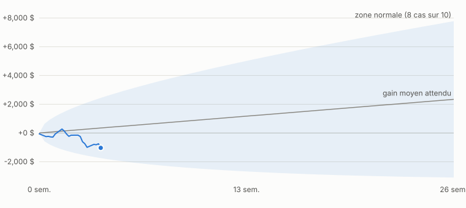
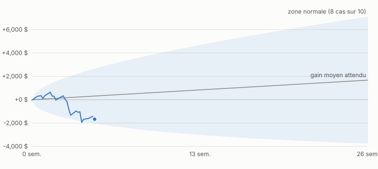

# Robot multi-marches : tableau de bord (argent virtuel)

Mis a jour le **2026-10-20**. Deux comptes virtuels de 50 000 $, risque vise 12 %/an (environ 6 000 $). Aucun argent reel n'est engage.

| Compte | Solde | Gain | Etat |
|---|---|---|---|
| Melange 50/50 (tendance + achat permanent) | 49,184 $ | -816 $ | 🟡 Dans la zone normale |
| Tendance seule | 48,922 $ | -1,078 $ | 🟡 Dans la zone normale |

La zone bleue de chaque graphique montre ou tombaient 8 resultats sur 10 dans l'historique 2007-2026, au meme risque. Tant que la ligne reste dedans, le compte se comporte comme prevu. Des semaines negatives sont normales : il faut plusieurs mois pour juger.

## Melange 50/50 (tendance + achat permanent)

Demarre le 2026-09-25. Historique 2007-2026 au meme risque : Sharpe 0,78, environ +9 %/an en moyenne, pire baisse -19 %, 3 annees sur 4 positives.

**🟡 Dans la zone normale : se comporte comme sur les 20 ans d'historique.**

| Mesure | Valeur |
|---|---|
| Solde virtuel | **49,184 $** (depart 50 000 $) |
| Gain depuis le depart | -816 $ (-1.6%) |
| Baisse depuis le plus haut | -2.2% |
| Zone normale a ce stade (8 cas sur 10) | de -1,694 $ a +2,337 $ (moyenne +321 $) |
| Challenge Phidias 50K virtuel | en cours : -816 $ sur +4 000 $, marge restante 1,408 $ |

| Contrat | Marche | Sens | Nombre |
|---|---|---|---|
| M6A | Dollar australien | Achat | 2 |
| 10Y | Taux 10 ans | Achat | 1 |
| 30Y | Taux 30 ans | Achat | 1 |
| MBT | Bitcoin | Achat | 1 |
| MET | Ether | Vente | 1 |

10 derniers jours

| Date | Resultat du jour | Solde |
|---|---|---|
| 2026-10-20 | -22 $ | 49,184 $ |
| 2026-10-19 | +204 $ | 49,206 $ |
| 2026-10-16 | -235 $ | 49,002 $ |
| 2026-10-15 | -137 $ | 49,254 $ |
| 2026-10-14 | -369 $ | 49,390 $ |
| 2026-10-13 | -93 $ | 49,759 $ |
| 2026-10-12 | +5 $ | 49,852 $ |
| 2026-10-09 | +81 $ | 49,846 $ |
| 2026-10-08 | -154 $ | 49,768 $ |
| 2026-10-07 | -210 $ | 49,923 $ |

Journal complet : [journal_melange.csv](journal_melange.csv)

## Tendance seule

Demarre le 2026-09-25. Historique 2007-2026 au meme risque : Sharpe 0,56, environ +7 %/an en moyenne, pire baisse -23 %, 13 annees sur 20 positives.

**🟡 Dans la zone normale : se comporte comme sur les 20 ans d'historique.**

| Mesure | Valeur |
|---|---|
| Solde virtuel | **48,922 $** (depart 50 000 $) |
| Gain depuis le depart | -1,078 $ (-2.2%) |
| Baisse depuis le plus haut | -3.4% |
| Zone normale a ce stade (8 cas sur 10) | de -1,784 $ a +2,246 $ (moyenne +231 $) |
| Challenge Phidias 50K virtuel | en cours : -1,078 $ sur +4 000 $, marge restante 778 $ |

| Contrat | Marche | Sens | Nombre |
|---|---|---|---|
| MET | Ether | Achat | 8 |
| 10Y | Taux 10 ans | Achat | 3 |
| 2YY | Taux 2 ans | Achat | 2 |
| MSF | Franc suisse | Vente | 2 |
| MJY | Yen | Vente | 1 |

10 derniers jours

| Date | Resultat du jour | Solde |
|---|---|---|
| 2026-10-20 | -113 $ | 48,922 $ |
| 2026-10-19 | +360 $ | 49,034 $ |
| 2026-10-16 | -492 $ | 48,675 $ |
| 2026-10-15 | -648 $ | 49,193 $ |
| 2026-10-14 | -204 $ | 49,841 $ |
| 2026-10-13 | -292 $ | 50,044 $ |
| 2026-10-12 | +267 $ | 50,336 $ |
| 2026-10-09 | +112 $ | 50,069 $ |
| 2026-10-08 | -336 $ | 49,963 $ |
| 2026-10-07 | -7 $ | 50,300 $ |

Journal complet : [journal.csv](journal.csv)

Contrats de taux (2YY, 10Y, 30Y) : le sens indique est celui de l'ordre sur le contrat, inverse de celui des obligations. Methode et resultats historiques : [../README.md](../README.md).
